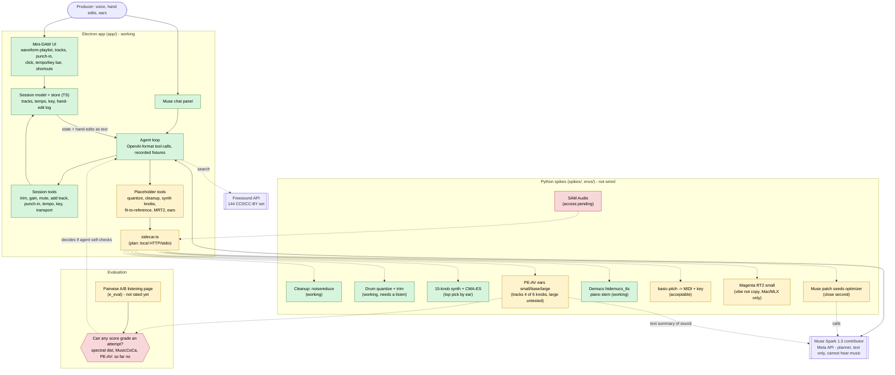
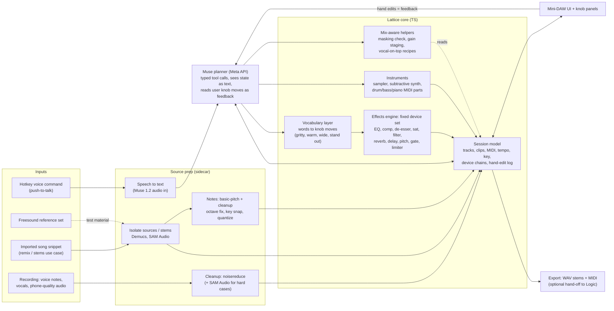

# Architecture (updated 2026-10-26, after the workflow interview)

> **2026-10-27 note:** diagram A is the day-1 snapshot and is out of date. Since then the effects
> engine (13 devices), the device panel and audio-to-MIDI (`extract_midi`) were built and wired in;
> the vocabulary layer exists only as seed data. Current status: `HANDOFF.md`; models by job:
> `docs/model-map.md`. Diagram B is still the target.

## A. Where we were on day 1 (2026-10-26)

Solid = working. Dashed = spike only, not wired into the app. Dotted = blocked or unproven.

## B. Where we are going

The user's workflow (see `session-plan.md`) is a **session-engineer** job: capture a sound, shape it with effects, add quantized MIDI parts, record vocals with a light chain, arrange lightly. Everything runs in Lattice, not Logic. The centre of the system becomes a **fixed effects engine with exposed knobs** that Muse drives, backed by a **vocabulary layer** ("gritty", "stand out in the mix") that turns words into knob moves. Hearing is a side-bet, not the spine.

**What is new relative to the first diagram**
- Effects engine and vocabulary layer are the main deliverable. The effects engine is built (Oct 27); the vocabulary layer is seed data only.
- Source prep (cleanup, isolation, audio to notes) is one pipeline that also serves the stems/remix use case.
- Synth+optimizer, MRT2 and PE-AV ears are demoted to **optional modules** ("recreate a reference", "grade an attempt").
- Muse never needs to hear: it picks from words plus session state, and the user judges by ear.

## Reading diagram A (day 1)

- **The gap that matters:** everything the agent can *do to sound* is in the dashed box. The app only has stubs. The sidecar is the bridge.
- **Muse is blind:** it plans from text. Any "listening" has to be a measurement or an embedding turned into text, which is why ears and self-grading are the open research questions.
- **Meta-central constraint:** Muse (planner), PE-AV, Demucs, SAM Audio are Meta. MRT2 (Google) and basic-pitch (Spotify) are not.
